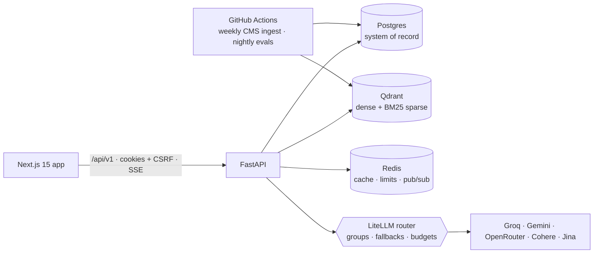

<div align="center">

# Necessa

**Medical-necessity intelligence for prior authorization and denial appeals.**

Necessa checks a patient's chart against the exact, version-correct coverage criteria of the applicable payer policy, one criterion at a time, with citations to both. Then it drafts the request or the appeal for a clinician to sign.

[Problem statement](docs/PROBLEM_STATEMENT.md) · [Architecture](docs/ARCHITECTURE.md) · [API contract](docs/API_CONTRACT.md) · [Design decisions](docs/adr/) · [Security](SECURITY.md)

</div>

---

## Why this exists

Physicians and their staff handle about **40 prior authorizations per physician every week** and spend about **13 hours** on them (AMA 2025 Prior Authorization Physician Survey). Most delays and denials don't happen because the care is unnecessary. They happen because the chart doesn't show what the policy asks for, in a form the reviewer can find. Since January 2026, CMS-0057-F requires many payers to decide in 72 hours (expedited) or 7 days (standard) and to give a specific reason for every denial. Incomplete requests now fail faster.

Necessa makes the gap visible **before** submission:

| Instead of | Necessa does |
|---|---|
| Reading a 40-page LCD and its billing article | Resolves the policy that applies to *this* payer, service, diagnosis, state and date of service |
| One yes/no guess from a chatbot | Judges every atomic criterion as **MET / NOT MET / INSUFFICIENT**, with the policy quote and the chart quote side by side |
| "No contraindication documented" counted as met | Three-valued logic: missing evidence never becomes "met" |
| Hand-written appeals | Drafts letters from verified facts only, maps the denial reason back to criteria |
| A coverage decision | **Documentation readiness**. A human always decides |

## What's inside

**A complete platform, not a demo chat window.** Organizations and onboarding, role-based access, a case worklist with payer-clock SLAs, a case workspace with live criterion-by-criterion evaluation, an evidence split view, gap checklists, letters and appeals, denials, a policy library with version diffs, a coverage-graph explorer, analytics with natural-language questions, knowledge operations, model and evaluation consoles, and an audit trail that verifies its own hash chain.

**Hybrid RAG that picks the right tool per question.**

| Question shape | Path |
|---|---|
| `What is LCD L33718?` / `E0601` | SQL exact match → BM25 fallback |
| "Which LCDs in Ohio list 64561?" | Parameterized tools → coverage graph → validated text-to-SQL |
| "What documentation is needed for facet joint blocks?" | Dense + BM25 sparse + full-text → RRF / weighted fusion → rerank chain |
| "nerve zapper for knee pain" | Dense-weighted hybrid + synonym expansion → HyDE |
| "Top missing criteria this month" | Text-to-SQL over tenant-scoped views (AST-validated, read-only, RLS) |
| Evidence for one criterion | Per-case chart retrieval with lookback window and negation-aware scoring |

Every answer carries a **retrieval trace** (intent, strategy, filters, per-stage scores, timings) that the UI shows in an inspector.

**Grounded by construction.** Criteria trees quote the policy verbatim, and a test fails if a single quote drifts. Verdicts must cite chart text that exists verbatim, and a second model from a different family checks entailment. Medicare contractors publish their own editions of the same LCD, so curated criteria transfer to another edition only when every quote re-grounds verbatim; otherwise they wait for human review.

**Free to run, no local models.** Every LLM, embedding and rerank call goes through LiteLLM to free tiers (Groq, Gemini, OpenRouter, Cohere, Jina; optional Mistral, Cerebras, GitHub Models) with per-group fallbacks, quota tracking and token budgets. Storage uses Neon Postgres, Qdrant Cloud and Upstash Redis free tiers. Missing keys degrade gracefully: sparse-only retrieval, deterministic checks and honest "LLM unavailable" flags.

## Quality, measured

Offline suites (deterministic fakes, so dense retrieval is effectively off) on **real CMS Medicare Coverage Database data**:

| Suite | Result | Gate |
|---|---|---|
| Retrieval, 61 questions across 11 query types | hit@10 **0.95** · recall@10 **0.83** · nDCG@10 **0.76** · MRR **0.81** | ≥ 0.90 / 0.70 / 0.75 / 0.60 |
| Verdicts, 338 counterfactual cases / 1,835 criteria | false-MET **0.0** · macro-F1 **0.99** · citation validity **1.0** | false-MET ≤ 0.02 |
| Faithfulness of drafted letters | unsupported claims **0** · PHI leaks **0** | 0 / 0 |
| Safety, 24 red-team probes (injection, PHI exfiltration, coverage-decision bait) | pass **1.0** | ≥ 0.95 |
| Criteria grounding (all curated sets) | **100%** verbatim | 100% |

Plus 250+ backend tests, end-to-end journey checks through the web proxy, and CI gates on every push. See [ARCHITECTURE.md §16](docs/ARCHITECTURE.md#16-evaluation--quality-gates).

## Architecture at a glance



- **Ingestion:** CMS MCD exports (953 LCDs, 2,053 articles, 357 NCDs, 427k covered-diagnosis rows, contractor jurisdictions) → sections → parent-child chunks with contextual headers → dense + in-house BM25 sparse vectors → blue/green Qdrant aliases with smoke evals and rollback.
- **Case evaluation (LangGraph):** deterministic policy resolution → criteria → per-criterion fan-out (retrieve → judge → verify → corrective retry) → Kleene aggregation → gaps → human review.
- **Safety:** de-identification before any provider call, PHI data-class enforcement in the router, injection screening of uploads and retrieved text, output policy filter (no coverage decisions, no clinical advice), hash-chained audit log, Postgres row-level security for generated SQL.

## Quick start

```bash
git clone https://github.com/moeiz16/necessa && cd necessa
make setup                 # Python venv + npm install, copies .env.example → .env
```

**1 · Frontend only (no backend, no keys)** shows the full product with an in-browser demo backend and simulated streams:
```bash
cd frontend && NEXT_PUBLIC_DEMO_MODE=true npm run dev     # http://localhost:3000 → "Explore the demo"
```

**2 · Full stack offline (no signups)** uses SQLite, embedded Qdrant and deterministic model fakes:
```bash
echo "LLM_FAKE=true" >> .env
make ingest-fixtures       # synthetic payer policies (no license needed)
make seed                  # demo org "Riverbend Orthopedics & Spine" + 14 evaluated cases
make dev                   # API :8000 + web :3000 — sign in as maya.okafor@riverbend.demo / Demo!Pass2026
```

**3 · Real data and real models.** Add any free keys to `.env` (`GROQ_API_KEY`, `GEMINI_API_KEY`, `COHERE_API_KEY`, …), optionally point `DATABASE_URL` / `QDRANT_URL` / `REDIS_URL` at Neon, Qdrant Cloud and Upstash, then:
```bash
ACCEPT_CMS_LICENSE=true make data    # downloads the CMS MCD CSV exports (~160 MB, stays local, git-ignored)
make ingest                          # focus scope: all NCDs + ~12 high-prior-auth service families
make eval                            # offline quality suites → eval/reports/
```

## Repository

```
backend/    FastAPI app — platform (auth, orgs, cases, audit, jobs), knowledge & hybrid RAG, case intelligence
frontend/   Next.js 15 app — design system, product UI, demo backend
eval/       datasets, generators and the evaluation harness
docs/       problem statement, architecture, API contract, ADRs
```

## Data and compliance notes

- **Synthetic patients only.** Free model tiers carry no BAA, so no real PHI should ever be loaded. The controls are still built as if it would be: de-identification, field encryption, audit, RBAC and tenant isolation.
- **CMS data is downloaded at runtime and never committed.** The MCD export includes AMA CPT® / ADA / AHA content under their license terms. This repository ships no CPT descriptors.
- **Necessa never decides coverage.** It reports documentation readiness and keeps a clinician in the loop, consistent with state laws that bar AI from being the sole basis of a denial.

## License

MIT, see [LICENSE](LICENSE). CPT® is a registered trademark of the American Medical Association.
