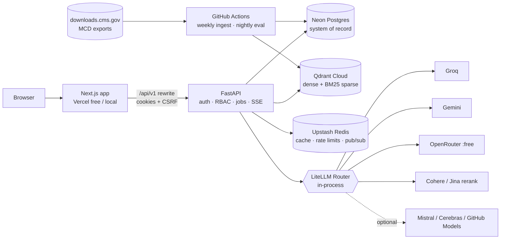
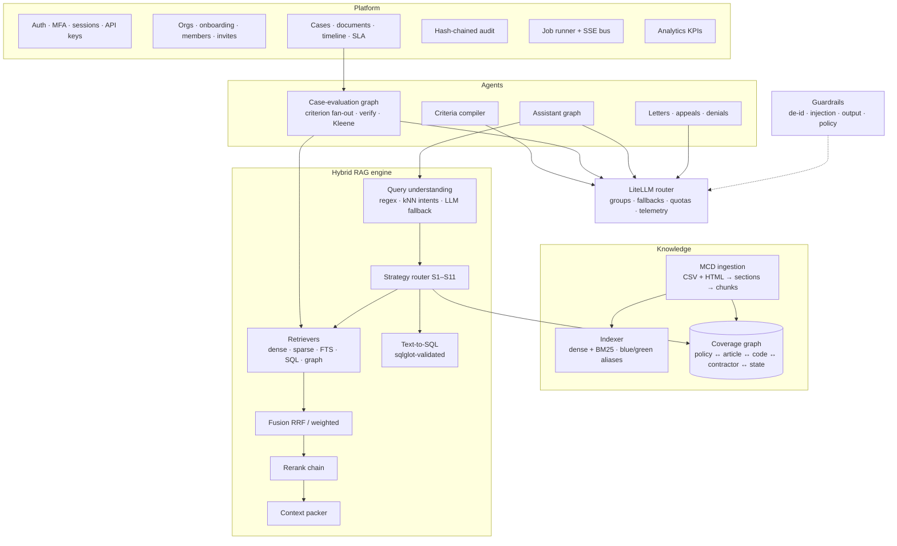

# Necessa — Architecture (as built)

> How the platform is put together under its real constraints: **no local model inference, ≤ 5 GB footprint, $0 run cost on managed free tiers**, and production-grade behavior anyway.
> The *why* (problem, requirements, compliance) lives in [PROBLEM_STATEMENT.md](PROBLEM_STATEMENT.md). Module boundaries and API shapes live in [API_CONTRACT.md](API_CONTRACT.md).

---

## 1. Constraints that shaped the design
| Constraint | Consequence |
|---|---|
| No local models (8 GB laptop, nothing to spare) | Every embedding, rerank, LLM and OCR call goes to a **cloud free tier through LiteLLM**. Sparse retrieval (BM25) is computed **in-house in pure Python**, with no model involved |
| ≤ 5 GB on disk, no local DB servers | **Neon Postgres**, **Qdrant Cloud** and **Upstash Redis** free tiers in "cloud mode". **SQLite + embedded Qdrant + in-process cache** in "offline mode" |
| Free tiers are rate-limited and change often | Config-only model roster, per-deployment RPM/RPD hints, quota tracking, cooldowns, fallbacks, a degradation ladder, and quota-paced batch jobs |
| Synthetic data only (portfolio) | Real CMS policy data + synthetic FHIR patients. PHI controls are still fully implemented (de-identification, encryption, audit, RBAC, data-class routing) |
| No ChromaDB | **Qdrant** for vectors (dense + sparse + payload filtering + aliases) |

## 2. Runtime modes
| Mode | DB | Vectors | Cache / pub-sub | LLMs | Use |
|---|---|---|---|---|---|
| **Cloud** | Neon Postgres (`postgresql+asyncpg`) | Qdrant Cloud | Upstash Redis | Groq / Gemini / OpenRouter / Cohere / Jina / … | Real usage, deployed demo |
| **Offline dev** | SQLite file | Embedded Qdrant (`data/qdrant`) | In-process | `LLM_FAKE=true` deterministic fakes, or any keys you have | Zero-signup local run |
| **Test** | SQLite temp | `QdrantClient(":memory:")` | In-process / fakeredis | Fakes | CI |
| **Frontend demo** | — | — | — | — | Next.js with a full in-browser mock backend + simulated streams (deployable to Vercel free) |

## 3. Deployment topology (cloud mode)

- **One deployable backend** (FastAPI). Background work runs in an **in-process, DB-backed job runner**: `jobs` rows survive restarts, and queued work resumes on boot. This avoids paying for a separate worker or broker on free tiers. The runner interface is the same one a Celery/Arq worker would use, so scaling out is a swap, not a rewrite.
- **Ingestion runs on GitHub Actions** (free for public repos). Data is downloaded and indexed straight into the cloud stores and **never uploaded as an artifact or committed** (CPT/ADA license terms).

## 4. Logical architecture

## 5. Knowledge ingestion (real CMS data)
**Source:** `downloads.cms.gov/medicare-coverage-database/downloads/exports/{current_lcd,current_article,ncd}.zip`. Only the CSV exports are extracted (≈160 MB); the 340 MB Access databases are discarded. Note: the CMS Coverage *API* is geo-blocked outside the US, but the bulk export host is not, so ingestion uses the exports.

| CSV | → | Necessa table / use |
|---|---|---|
| `lcd.csv` (953 LCDs; HTML fields `indication`, `doc_reqs`, `coding_guidelines`, `associated_info`, `summary_of_evidence`, `analysis_of_evidence`, `cms_cov_policy`, `util_guide`, dates `orig_det_eff_date`, `rev_eff_date`, `rev_end_date`, `date_retired`) | → | `policies`, `policy_versions`, `policy_sections` |
| `article.csv` (2,053 articles; `description`, `other_comments`, type lookup → "Billing and Coding") | → | same |
| `ncd/ncd_trkg.csv` (357 NCDs; `itm_srvc_desc`, `indctn_lmtn`, manual section, effective/termination dates) | → | same |
| `lcd_x_hcpc_code`, `article_x_hcpc_code` (+ `_group` paragraphs) | → | `policy_codes` (HCPCS), `policy_code_groups` |
| `article_x_icd10_covered` (427k rows), `article_x_icd10_noncovered` (+ groups) | → | `policy_codes` (ICD10_COVERED/NONCOVERED) |
| `lcd_related_documents`, `article_related_documents`, `lcd_related_ncd_documents` | → | `policy_links` (LCD ↔ Article ↔ NCD) |
| `contractor`, `contractor_jurisdiction`, `state_lookup`, `lcd_x_contractor`, `article_x_contractor`, `lcd_x_primary_jurisdiction` | → | `contractors`, `contractor_states`, `states`, `policy_contractors`, `policy_states` |
| `lcd_x_revision_history`, `article_x_revision_history` | → | version history + diff source |

**Pipeline:** parse (UTF-8; HTML → normalized text with headings/lists/tables kept as Markdown) → sectionize → incremental diff by content hash → section-aware recursive chunking with **parent-child** (child 200–400 tokens, parent ≤ 1,500) and a **deterministic contextual header** (`[Medicare LCD L33718 v12 · Billing and Coding · Documentation Requirements · Effective 2026-01-01 · Contractors: …]`) → dense embeddings (one pinned model) + **BM25 sparse vectors** → upsert into a **new physical Qdrant collection** → smoke-eval → **atomic alias swap** (rollback = swap back).

**Scopes:** `focus` (all NCDs + LCDs/Articles for ~12 high-prior-auth service families; see contract §8) keeps embedding quotas and the 1 GB Qdrant free tier comfortable. `full` is resumable over several days. `fixtures` uses hand-written synthetic policies for tests and offline demos.

## 6. Hybrid retrieval
### 6.1 Channels
| Channel | Implementation | Strength |
|---|---|---|
| **Dense** | `gemini-embedding-001` @ 768-d (Matryoshka-truncated, L2-normalized → cosine), Qdrant HNSW (`m=16`, `ef_construct=200`), int8 scalar quantization + rescoring on Qdrant Cloud | Paraphrase, lay language |
| **Sparse (BM25)** | In-house tokenizer that keeps codes intact (`E0601`, `M17.11`, `L33718`, `29877`), snowball stemming, stopwords, stable 32-bit term hashing, BM25 TF saturation (k1=1.2, b=0.75), **IDF applied server-side by Qdrant** (`Modifier.IDF`) | Exact terms, rare words, codes |
| **Lexical FTS** | Postgres `tsvector` (`websearch_to_tsquery`) / SQLite FTS5 over `policy_sections` | Phrase matches, grounding, a fallback when vectors are degraded |
| **SQL** | Parameterized tools + validated text-to-SQL over allowlisted views | Identifiers, aggregates, coverage facts |
| **Graph** | Recursive traversal over relational coverage edges | Multi-hop: code → article → LCD → contractor → state |

### 6.2 Strategy matrix (query understanding picks one; forceable via `strategy`)
| | Scenario | Path |
|---|---|---|
| S1 | Exact identifier (`L33718`, `E0601`) | SQL exact → sparse fallback |
| S2 | Structured coverage fact ("which LCDs in OH list 64561") | Tools/graph → text-to-SQL |
| S3 | Analytics over own cases | Text-to-SQL (tenant-scoped views, small-cell suppression) |
| S4 | Conceptual policy question | Dense + sparse (+FTS) with filters → RRF → rerank |
| S5 | Lay language / paraphrase | Dense-weighted + synonym expansion (code descriptors) → HyDE if still weak |
| S6 | Keyword-heavy / rare term | Sparse-weighted hybrid |
| S7 | Chart evidence for a criterion | Per-case tenant-filtered hybrid + lookback window + negation-aware scoring |
| S8 | Multi-hop / mixed | Decompose → S2 + S4 → merge with provenance |
| S9 | Version comparison | Version table → section-aligned diff → retrieval in both versions |
| S10 | Denial reason → criteria | Hybrid over the compiled-criteria index |
| S11 | Out of scope / unsafe | Guardrail → abstain with an explanation |

**Self-query filters** come from the query and the context: `as_of` (date of service), `states` → contractor jurisdictions, `doc_types`, `codes`, `policy_version_ids`. Filters are applied **inside** the vector search (payload indexes), never after it.

### 6.3 Fusion & reranking
1. Prefetch: dense top-50 + sparse top-50 (+ FTS top-50) → **RRF (k=60)** or **weighted RRF** with per-intent weights (S5 dense-heavy, S6 sparse-heavy), or **z-score convex fusion** when calibrated scores are needed. The method is chosen by eval.
2. **Rerank chain (all API, no local models):** Cohere Rerank → Jina Reranker → **LLM listwise rerank** (`router-small`, IDs only, triggered on low top-1/top-2 margin or for multi-hop) → none (fusion order, flagged `degraded`).
3. Post-processing: near-duplicate removal, **MMR** (λ=0.7), parent expansion, trust weighting (NCD > LCD > Article > payer for Medicare; current > superseded), and **lost-in-the-middle ordering** (best chunks at the edges).
4. **Corrective loop (CRAG-style):** a weak top score triggers rewrite / expansion / one filter relaxation (logged), at most 2 iterations, then **abstain**.

## 7. Text-to-SQL & coverage graph
- **Ladder:** parameterized tools first (`resolve_policies`, `find_policies_by_code`, `covered_dx_for_policy`, …), then text-to-SQL for the long tail.
- **Text-to-SQL:** schema-aware retrieval of view docs → dynamic few-shot from verified NL→SQL pairs → generation (`sql` group) → **sqlglot AST validation**: single `SELECT`, allowlisted views only, `LIMIT` enforced, no unconstrained cross joins, function blocklist, mandatory tenant predicate → `EXPLAIN` / timeout → read-only execution → self-correction ≤ 2 → result table + the SQL shown to the user + a chart hint.
- **Coverage graph** is built **from structured CMS tables, not from LLM extraction**, so it is exact and costs nothing. It is served as nodes and edges for the UI (React Flow).

## 8. Case evaluation (LangGraph)
`resolve_policies (deterministic) → load approved criteria → index chart (de-identified chunks) → fan-out per criterion → retrieve evidence (S7) → judge (structured verdict, temp 0) → verify (verbatim quote + entailment by a different model family) → corrective retrieval ≤ 2 → Kleene 3-valued aggregation → gaps + fixes → human review (interrupt) → persist + audit`
- Verdicts are `MET / NOT_MET / INSUFFICIENT`. **Negative-attestation criteria can never be MET because evidence is absent.**
- The final status is **documentation readiness** (`ready / gaps / not_supported`), never a coverage decision.
- Guards: recursion limit, per-case token budget, per-node timeouts, bounded concurrency (free-tier RPM), cancellation.
- **Degraded mode** (no LLM keys or quota exhausted): lexical evidence finder + deterministic temporal/numeric rules. Everything else becomes `INSUFFICIENT` with "LLM unavailable". The UI shows the degradation clearly.

## 9. Multi-LLM routing (LiteLLM, in-process)
| Group | Purpose | Primary → fallbacks (free tiers; ids are config) |
|---|---|---|
| `router-small` | intent fallback, rewrite, decomposition, listwise rerank | Groq `llama-3.1-8b-instant` → Gemini `2.5-flash-lite` → OpenRouter free |
| `qa-public` | assistant answers (public policy data) | Groq `llama-3.3-70b-versatile` → Gemini `2.5-flash` → OpenRouter free |
| `judge` | per-criterion verdicts (de-identified evidence) | Gemini `2.5-flash` → Groq `openai/gpt-oss-120b` → OpenRouter free |
| `verifier` | entailment / cross-check (**a different family than the judge**) | Groq `qwen/qwen3-32b` or `gpt-oss` → Mistral (if key) |
| `sql` | text-to-SQL | Groq `openai/gpt-oss-120b` → Gemini `2.5-flash` |
| `drafter` | letters/appeals (de-identified facts, rehydrated locally) | Groq `llama-3.3-70b-versatile` → Gemini `2.5-flash` |
| `compiler-longctx` | criteria extraction from long policies (offline) | Gemini `2.5-flash` (long context) → Groq `gpt-oss-120b` |
| `ocr-vision` | scanned PDF pages → text | Gemini `2.5-flash` (vision) |
| `guard` | injection / unsafe-request classification | Groq `llama-3.1-8b-instant` → Gemini `flash-lite` |
| embeddings | pinned | `gemini/gemini-embedding-001` @ 768 |
| rerank | chain | Cohere `rerank-v3.5` → Jina `jina-reranker-v2-base-multilingual` → LLM listwise |

- **Reliability:** deployments are built only for keys that exist. LiteLLM retries with backoff honoring `Retry-After`, then cooldowns, then group fallbacks. A daily quota tracker shifts traffic before 429s happen. Per-request and per-org token budgets cap spend.
- **Data-class enforcement:** `PHI` calls require `deidentified=True` and a group in `phi_allowed_groups`. A secondary regex scan blocks payloads that still look identifying. Production would point `phi_allowed_groups` at BAA-covered endpoints (e.g. Claude via a BAA-covered platform) by config.
- **Telemetry:** every call writes an `llm_calls` row (provider, model, tokens, latency, cache hit, fallback, status). This powers the Models & Providers admin page. An optional Langfuse Cloud callback adds traces.

## 10. PHI handling without local models
1. At intake, structured identifiers are known from the FHIR `Patient` resource (name, DOB, MRN, member ID, address, phone) and are replaced **exactly** with consistent tokens (`[PATIENT_NAME_1]`). Regex recognizers then catch residual patterns (dates, phones, emails, SSN, NPI, ZIP, titled names).
2. Raw text is stored **Fernet-encrypted** (`text_enc`). Only de-identified text (`text_deid`) is chunked, embedded, retrieved and sent to models.
3. Drafts are generated on tokens and **rehydrated locally** at render time. Revealing PHI in the UI is an explicit, audited action.
4. Logs pass through a PHI-redaction processor. The audit log stores actions and IDs, never clinical text.

## 11. Caching
| Layer | Store | Key / invalidation |
|---|---|---|
| Exact answer cache | Redis → `response_cache` table fallback | hash(query, filters, index version, prompt version, model) |
| Semantic cache | Qdrant `semantic_cache` collection | cosine ≥ τ **and** equal entities (codes, payer, state, as-of, negations such as with/without contrast); scoped to the index version |
| Retrieval cache | Redis/memory | hash(query, filters, index version) |
| Embedding cache | Redis/table | content hash + model |
| LLM call cache | LiteLLM / table | temperature-0 calls only |
| Compiled criteria | Postgres | immutable per policy version |

## 12. Guardrails & security (summary)
- **Input:** injection heuristics + `guard` model on user input **and** on uploaded/retrieved text; quarantine of malicious documents; size/MIME limits.
- **Retrieval:** relevance thresholds with abstention, source allowlist, tenant filter injected server-side.
- **Output:** Pydantic schemas with a repair retry, verbatim-citation validation, entailment check, a policy filter (no coverage decisions, no clinical advice).
- **App security:** argon2id passwords, short-lived JWTs, rotating refresh tokens with reuse detection, TOTP MFA + recovery codes, CSRF double-submit, RBAC + tenant isolation (Postgres RLS in migrations), API keys (hashed, prefix-identified), rate limiting (stricter on auth), security headers, hash-chained tamper-evident audit log with a verify endpoint.
- **Supply chain / CI:** gitleaks, Bandit, pip-audit, ruff, typed code, lockfiles.

## 13. Degradation ladder
| Failure | Behavior |
|---|---|
| Embedding provider down / no key | Sparse + FTS + SQL retrieval; `degraded: ["dense"]` in the trace |
| Reranker chain exhausted | Fusion order with MMR; `degraded: ["rerank"]` |
| LLM group exhausted | Assistant returns a retrieval-only answer (cited passages); case evaluation runs in degraded mode |
| Redis unavailable | In-process cache/pub-sub (single instance) |
| Qdrant Cloud paused (free tier inactivity) | Readiness reports `qdrant: paused`; FTS-only retrieval |

## 14. Scalability path
Stateless API replicas behind a load balancer, with Redis pub/sub for SSE fan-out. Job runner → Arq/Celery workers on the same `jobs` interface. Qdrant distributed mode with tenant shard keys and replication. Neon autoscaling + read replicas. Batch embedding on schedules. Provider swaps to paid or BAA-covered endpoints via `models.yaml`.

## 15. Architecture decision records
See [`docs/adr/`](adr/). Key ones: 001 criteria-first evaluation · 002 Qdrant · 003 managed free tiers over local inference · 004 in-house BM25 sparse vectors · 005 Postgres as system of record · 006 graph from structured data · 007 tools before text-to-SQL · 008 in-process job runner · 009 single orchestrated graph over multi-agent · 010 code-level guardrails · 011 no fine-tuning in v1.
